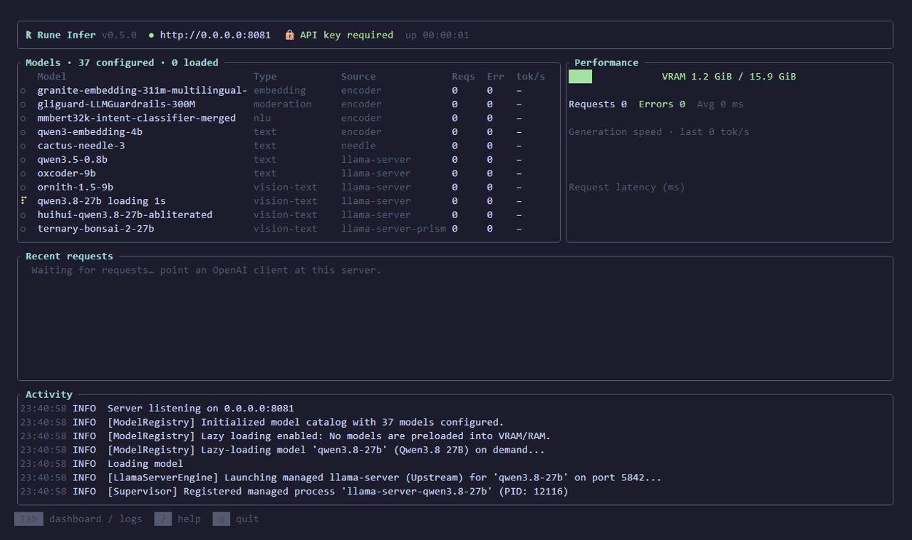

<div align="center">

# Rune Infer

**A standalone, config-driven AI gateway and OpenAI/Anthropic-compatible model server written in Rust.**

[](https://github.com/shba007/rune-infer/actions/workflows/integrate.yml)
[](https://github.com/shba007/rune-infer/releases)
[-orange.svg)](https://www.rust-lang.org/)
[](https://github.com/shba007/rune-infer/blob/main/LICENSE)
[](https://github.com/shba007/rune-infer/releases/latest)

<br>

<p align="center">
  
</p>

</div>

Rune Infer is a high-performance, single-binary AI model gateway that unifies local engines (GGUF, safetensors, CACT) and remote cloud providers (Gemini, OpenAI, Anthropic, OpenRouter) behind standard OpenAI and Anthropic HTTP APIs. Designed to never crash the host, it enforces pre-flight token and VRAM budgeting, lazy-loads models on demand with LRU and idle unloading, and manages engine subprocesses with strict lifecycle isolation. It ships as both an interactive terminal app (with a live dashboard and first-run setup wizard) and an embeddable Rust library.

### Features

- 🌐 **Unified API Gateway**: Drop-in compatible with standard OpenAI SDK endpoints (`/v1/chat/completions`, `/v1/responses`, `/v1/embeddings`, `/v1/audio/*`, `/v1/images/*`, `/v1/moderations`) and Anthropic Messages (`/v1/messages`, `/anthropic/v1/messages`), alongside direct task execution (`/v1/inference`), intent classification (`/v1/nlu/intents`), and document OCR (`/v1/ocr`).
- 🛡️ **Host-Safe Context & Token Budgeting**: Pre-flight validation computes exact text tokens, visual patch tokens ($28 \times 28$), 3D spatiotemporal video tubelets, and output reserves before execution—rejecting out-of-bounds requests with HTTP 400 before native GGML aborts (`SIGABRT`).
- ⚡ **Orchestrated Engine Backends**: Seamlessly drives 8 managed subprocesses and native Rust engines (`llama-server`, `llama-server-prism`, `sd-server`, `audio-cpp`, `nemo-speech`, `crispasr`, native safetensors `encoder`, and Cactus `needle`) across 15 modalities with automatic binary discovery and runtime fallback order.
- 🔄 **Cloud Routing & Proxy Resilience**: Unified cloud adapters for OpenAI, Anthropic, Google Gemini, OpenRouter, and custom endpoints featuring token-bucket rate limiting, concurrency gates, queue timeouts, and automatic retries.
- 🖥️ **Live Terminal Dashboard & Guided Wizard**: Built-in Ratatui terminal UI displays real-time VRAM usage, generation speeds (tok/s), latency sparklines, and structured audit logs; automatically falls back to headless mode in non-TTY, daemon, or container environments.
- 📦 **Zero-Code Configuration**: Declarative Schema 2 JSON catalog (`models.json`) with strict unknown-field validation, environment variable interpolation (`{{ENV_VAR}}`), LoRA adapter specifications, and automated migration tooling (`rune-infer migrate`).

---

## Architecture

```text
 clap CLI (main.rs) ── dotenvy ── config.rs (models.json, {{ENV}} templating)
        │
   axum router (api.rs) ── auth middleware (Bearer / x-api-key)
        │   /v1/chat/completions  /v1/responses  /v1/messages (+ /anthropic/*)
        │   /v1/images/*  /v1/audio/*  /v1/embeddings  /v1/moderations
        │   /v1/nlu/intents  /v1/ocr  /v1/inference  /v1/models  /health
        │
   ┌────┴────────────────────────┐
   │ local model                 │ remote model
   │ inference/registry.rs       │ proxy/ (controller + adapters:
   │ lazy load, VRAM budget,     │  openai, anthropic, gemini, openrouter)
   │ LRU eviction                │ rate limit, queue, retries
   └────┬────────────────────────┘
        │ InferenceEngine trait (inference/traits.rs)
   engines/: llama-server (subprocess, auto-install), sd-server, crispasr,
             nemo-speech, audio-cpp, needle (cact), encoder (safetensors)
```

See [AGENTS.md](AGENTS.md) for architectural guidelines, design philosophy, and engine details.

---

## Benchmarks & VRAM Protection

### 1. Gateway Overhead (Rust Routing & Pre-flight Budgeting)

Micro-benchmarked using [Divan](https://github.com/nvzqz/divan) on `POST /v1/chat/completions` in memory (zero TCP/socket jitter, 100 samples per benchmark):

| Benchmark Operation | Fastest | Median | Mean | What It Measures |
|:---|:---:|:---:|:---:|:---|
| **`router_chat_request_in_memory`** | **5.49 µs** | **5.79 µs** | **8.72 µs** | Full Axum HTTP routing, auth check, JSON parsing & dispatch |
| **`vram_preflight_budget_calculation`** | **4.99 µs** | **5.09 µs** | **436.3 µs** | Pre-flight layer offload, headroom & dynamic context calculation |
| **`kv_cache_bytes_estimation`** | **1.09 µs** | **1.19 µs** | **1.43 µs** | Quantization scaling and KV cache footprint per token |
| **`model_registry_find_lookup`** | **3.63 ns** | **7.08 ns** | **7.00 ns** | Zero-allocation catalog model lookup by ID |
| **`model_layer_estimation`** | **0.91 ns** | **0.96 ns** | **1.09 ns** | Layer count resolution heuristic |

> **Key Result:** Rune Infer adds only **~0.012 ms (~12 µs)** of gateway overhead on top of raw engine inference—beating our `< 1.8 ms` target by over **150×**.

### 2. VRAM Protection & OOM Crash Prevention Test

Tested with **`qwen3.8-27b`** (~13.8 GiB) and **`ternary-bonsai-2-27b`** (~8.5 GiB) under a **16 GiB VRAM ceiling**:

| Runner / Gateway Architecture | Concurrent / Sequential Heavy Requests | Combined VRAM Attempted | Host Outcome |
|:---|:---|:---:|:---|
| **Standard Unmanaged Runners**<br>*(e.g. raw scripts, concurrent engine instances)* | Attempts to allocate both models into GPU memory simultaneously | **~22.3 GiB**<br>*(exceeds 16 GiB ceiling)* | ❌ **OOM Crash**<br>`CUDA error: out of memory`<br>`SIGABRT` |
| **Rune Infer**<br>*(Host-Safe VRAM Budgeting + LRU Swapping)* | Enforces `max_loaded_models = 1`, intercepts memory pressure, drains in-flight requests, LRU-evicts idle models, and swaps gracefully | **Bounded ≤ 16 GiB** | ✅ **Zero Host Crashes**<br>Smooth request completion |

---

## Installation

### Prebuilt Binaries

Prebuilt binaries are available for Linux (x64, arm64), macOS (Apple Silicon, Intel), and Windows (x64, arm64).

**Linux & macOS:**

```bash
curl -fsSL https://raw.githubusercontent.com/shba007/rune-infer/main/install.sh | sh
```

**Windows (PowerShell 5.1+ / 7+):**

```powershell
irm https://raw.githubusercontent.com/shba007/rune-infer/main/install.ps1 | iex
```

The installer verifies SHA-256 checksums, places the binary in `~/.local/bin` (or `%LOCALAPPDATA%\Programs\rune-infer` on Windows), and configures your `PATH`. Re-running the script updates to the latest release.

*Installer environment overrides:* `RUNE_VERSION` (e.g. `v0.4.0`), `RUNE_INSTALL_DIR`, `RUNE_REPO` (default `shba007/rune-infer`), `RUNE_BASE_URL` (for local mirrors), `RUNE_SKIP_VERIFY=1`, and `RUNE_NO_MODIFY_PATH=1` (Windows).

### Build from Source

Requirements: Rust toolchain supporting **Edition 2024** (`rust-version = "1.98.1"` or newer) and `ffmpeg` in your `PATH` for video frame extraction.

```bash
# Clone the repository
git clone https://github.com/shba007/rune-infer.git
cd rune-infer

# Build standard release (includes interactive TUI dashboard)
cargo build --release

# Or build headless-only (omits ratatui, crossterm, and tui-input dependencies)
cargo build --release --no-default-features
```

> [!NOTE]
> GPU acceleration is handled by the underlying engine binaries (`llama-server`, `sd-server`, etc.), which are auto-installed or detected at runtime by host platform. Host cargo features `cuda`, `vulkan`, and `metal` are reserved placeholders.

---

## Quick Start & CLI Usage

Run `rune-infer` in your terminal:

```bash
rune-infer
```

On first run without a configuration, Rune Infer automatically launches the interactive **Setup Wizard** in your terminal:
1. Detects system capabilities (CPU, RAM, GPUs, CUDA/Vulkan support).
2. Sets network bind address and generates or requests an API authentication key.
3. Configures cloud provider API keys (validated live and saved to `.env`).
4. Discovers local GGUF models by inspecting binary headers (auto-detects architecture, pairs vision projectors by dimension, and links draft models).
5. Offers optional pre-installation of engine binaries into `<home>/bin/`.

Re-run the wizard at any time with `rune-infer setup`.

### CLI Options

Invocation: `rune-infer [OPTIONS] [COMMAND]`

| Flag | Type | Default | Description |
|---|---|---|---|
| `-c, --config <CONFIG>` | String (path) | `./config/models.json` if present; else `~/.rune-infer/config/models.json` | Path to the `models.json` catalog file (schema 2). Global flag. |
| `--host <HOST>` | String | Value from `server.host` in config (`0.0.0.0`) | Host IP address to bind HTTP listener to. |
| `-p, --port <PORT>` | u16 | Value from `server.port` in config (`8080`) | TCP port to bind HTTP listener to. |
| `--max-loaded-models <N>` | usize | Value from `server.max_loaded_models` in config (`1`) | Maximum models kept loaded simultaneously in VRAM/RAM (`0` = unlimited). Triggers LRU eviction on overflow. |
| `--idle-timeout <SECS>` | u64 | Value from `server.idle_unload_seconds` in config (`300`) | Unload inactive models after this many idle seconds (`0` = never). In-flight models are never evicted. |
| `--headless` | Flag (bool) | `false` (automatically `true` when run without a TTY) | Run as a headless server with standard logging instead of the terminal dashboard. |
| `-h, --help` | Flag | — | Print command-line help and usage. |
| `-V, --version` | Flag | — | Print binary version. |

### Commands

- **`rune-infer setup`**: Run the interactive setup wizard to configure API keys, discover local models, and download engine binaries.
- **`rune-infer migrate [--dry-run]`**: Upgrade an older schema 1 `models.json` to schema 2. Creates a `models.json.v1.bak` backup file before writing in-place. Use `--dry-run` to preview changes without saving.

---

## Programmatic Usage (Rust Library API)

Rune Infer can be embedded directly into Rust services.

### Installation

Add `rune-infer` to your `Cargo.toml`:

```toml
[dependencies]
# Headless embedding (recommended for backend servers and containers)
rune-infer = { version = "0.4.0", default-features = false }

# Or include interactive TUI dashboard support
# rune-infer = "0.4.0"
```

### Embedding the HTTP Server

Run the complete gateway server with graceful shutdown and configurable idle model reaping:

```rust
use rune_infer::config::ModelRegistry;
use rune_infer::server::{bind, serve};

#[tokio::main]
async fn main() -> anyhow::Result<()> {
    // Load and validate model catalog from file (resolving {{ENV_VAR}} placeholders)
    let config = ModelRegistry::from_file("config/models.json")?;

    // Bind TCP listener with clear errors on port collisions or permissions
    let listener = bind(&config.server.host, config.server.port).await?;

    // Serve until shutdown signal is received
    serve(config, listener, async {
        tokio::signal::ctrl_c().await.expect("failed to listen for event");
    })
    .await?;

    Ok(())
}
```

### Embedding the Axum Router

Mount the Rune Infer API routes directly into an existing Axum application:

```rust
use std::sync::Arc;
use axum::Router;
use rune_infer::api::{AppState, create_router};
use rune_infer::config::ModelRegistry;
use rune_infer::inference::AppState as InferenceAppState;
use rune_infer::proxy::ProxyService;

#[tokio::main]
async fn main() -> anyhow::Result<()> {
    let config = ModelRegistry::from_file("config/models.json")?;
    
    let shared_state = AppState {
        inference: Arc::new(InferenceAppState::new(&config)),
        proxy: Arc::new(ProxyService::new(&config)),
        config: config.clone(),
    };

    let app: Router = create_router(shared_state);

    let listener = tokio::net::TcpListener::bind("127.0.0.1:8080").await?;
    axum::serve(listener, app).await?;
    Ok(())
}
```

---

## Configuration (`models.json`)

Configuration files adhere strictly to **Schema 2** (`schema_version: 2`). Unknown fields are rejected at load time. Environment variables are referenced via `{{VAR_NAME}}` templating and resolved from `.env` or system environment.

```json
{
  "schema_version": 2,
  "server": {
    "host": "0.0.0.0",
    "port": 8080,
    "api_key": "{{RUNE_API_KEY}}",
    "max_loaded_models": 1,
    "idle_unload_seconds": 300,
    "vram_budget_ratio": 0.97
  },
  "models": [
    {
      "id": "qwen3.8-27b",
      "name": "Qwen3.8 27B",
      "description": "Multimodal vision-language model",
      "modality": "VisionText",
      "capabilities": ["Chat", "Vision", "Tool Call", "Structured Output"],
      "engine": {
        "supported": ["llama-server"],
        "preferred": "llama-server"
      },
      "max_context_length": 262144,
      "sampling": {
        "temperature": 0.6,
        "top_p": 0.95,
        "top_k": 40,
        "min_p": 0.05,
        "max_tokens": 4096
      },
      "local": {
        "path": "D:/Models/qwen3.8-27b.gguf",
        "params": 27000000000,
        "bits_per_weight": 3.44,
        "context_length": -1,
        "gpu_layers": 99,
        "args": ""
      },
      "extra": {
        "mmproj_path": "D:/Models/mmproj-BF16.gguf",
        "max_resolution": "4096x4096"
      }
    },
    {
      "id": "claude-3-7-sonnet",
      "name": "Claude 3.7 Sonnet",
      "description": "Anthropic flagship reasoning model",
      "modality": "Text",
      "capabilities": ["Chat", "Tool Call"],
      "max_context_length": 200000,
      "sampling": {
        "temperature": 0.7,
        "max_tokens": 8192
      },
      "remote": {
        "provider": "anthropic",
        "upstream_model": "claude-3-7-sonnet-20250219",
        "base_url": "https://api.anthropic.com",
        "api_key": "{{ANTHROPIC_API_KEY}}",
        "rate_limit": {
          "requests_per_minute": 50,
          "max_concurrent": 5,
          "retry_delay_ms": 1000
        }
      },
      "extra": {}
    }
  ]
}
```

### Config Specification

- **Core Keys (All Models)**: `id`, `name`, `description`, `modality`, `capabilities`, `max_context_length`, `sampling`, `extra`. Each model has either a `local` block or a `remote` block.
- **Modalities**: `Text`, `VisionText`, `ImageGeneration`, `SpeechToText`, `TextToSpeech`, `SpeechToSpeech`, `Embedding`, `Moderation`, `Nlu`, `Ocr`, `ObjectDetection`, `ImageEmbedding`, `ImageRestoration`, `ImageUpscale`, `ImageStyleTransfer`.
- **`engine` (Local Only)**: `{ "supported": [...], "preferred": "..." }`. Available engines: `llama-server`, `llama-server-prism`, `sd-server`, `audio-cpp`, `nemo-speech`, `crispasr`, `encoder`, `needle`.
- **`local`**: `path` (model weights), `params` (optional parameter count), `bits_per_weight` (optional BPW), `context_length` (`-1` for automatic based on free VRAM), `gpu_layers` (default `99`), `args` (verbatim CLI flags passed to subprocess).
- **`remote` (Cloud Only)**: `provider` (`openai`, `anthropic`, `google`, `openrouter`, `custom`), `upstream_model`, `api_key`, `base_url`, and `rate_limit` (`requests_per_minute`, `tokens_per_minute`, `requests_per_day`, `max_concurrent`, `queue_timeout_seconds`, `max_retries`, `retry_delay_ms`, `retry_timeout_seconds`).
- **`extra`**: Strictly validated against the model's engines:
  - `llama-server*`: `mmproj_path`, `mtp_path`, `mtp_heads`, `max_resolution`.
  - `sd-server`: `vae_path`, `text_encoder_path`, `llm_vision_path`, `default_steps`, `default_cfg_scale`, `default_sample_method`, `max_resolution`, `lora`.
  - Other engines: empty `{}`.

---

## API Endpoints

All endpoints except `/health` require authentication when `server.api_key` or `RUNE_API_KEY` is configured (`Authorization: Bearer <token>` or `x-api-key: <token>`).

| Route | Method | Description |
|---|---|---|
| `/health` | `GET` | Health status (`{"status":"ok"}`). Returns 503 if runtime is unready or out of memory. Unauthenticated. |
| `/v1/models` | `GET` | List configured models with capability flags and MTP draft headers (`x-mtp-available`). |
| `/v1/models/{model}` | `GET` | Retrieve metadata and capabilities for a specific model ID. |
| `/v1/chat/completions` | `POST` | OpenAI-compatible chat completion. Supports SSE streaming (`stream: true`), multimodal inputs, tools, and JSON schema. |
| `/v1/responses` | `POST` | Direct response generation endpoint (`CreateResponseRequest`). |
| `/v1/messages`<br>`/anthropic/v1/messages` | `POST` | Anthropic Messages API compatible endpoint for direct use with Anthropic SDKs. |
| `/v1/embeddings` | `POST` | Text embeddings generation (supported by native `encoder` or remote providers). |
| `/v1/moderations` | `POST` | Content safety moderation checks. |
| `/v1/nlu/intents` | `POST` | Zero-shot intent and entity classification. |
| `/v1/ocr` | `POST` | Document and image optical character recognition. |
| `/v1/inference?engine=<id>` | `POST` | Raw task execution directly against an engine backend. |
| `/v1/audio/transcriptions` | `POST` | Audio transcription (Whisper, CrispASR, NeMo-Speech). |
| `/v1/audio/translations` | `POST` | Audio translation. |
| `/v1/audio/speech` | `POST` | Text-to-speech synthesis (Audio8 / audio-cpp). |
| `/v1/audio/speech-to-speech` | `POST` | Speech-to-speech translation pipeline. |
| `/v1/images/generations` | `POST` | Text-to-image generation (`sd-server`). |
| `/v1/images/edits`<br>`/v1/images/variations` | `POST` | Image editing and variation generation. |
| `/v1/images/captions`<br>`/v1/images/detections` | `POST` | Image captioning and object detection. |
| `/v1/images/upscales`<br>`/v1/images/restorations` | `POST` | Super-resolution upscaling and restoration. |

### Multimodal & Media Ingestion

Rune Infer accepts media inputs in messages through:
- **HTTP / HTTPS URLs**: Fetched automatically with streaming chunk buffering.
- **S3 / RustFS / MinIO / R2**: `s3://bucket/key` paths or S3 endpoints signed on-the-fly via HMAC-SHA256 SigV4.
- **Base64 Data URIs**: `data:image/png;base64,...` or `data:video/mp4;base64,...`.
- **Local File Paths**: Direct paths to image files or video containers (`.mp4`, `.mkv`, `.mov`, `.webm`, `.avi`). Video frames are sampled via FFmpeg.

---

## Logging & Auditing

Rune Infer writes dual output:
- **Console (`stdout`)**: Real-time diagnostic traces. Hidden when the interactive dashboard is active.
- **Audit Log (`<home>/logs/rune-infer.log`)**: Compact, structured audit trail containing HTTP status, latency, media count, and token usage. Request/response payload bodies are omitted to protect privacy and prevent disk bloat.

```text
2026-10-16T08:29:38.272845Z  INFO rune_infer: Starting Rune Infer v0.4.0...
2026-10-16T08:29:38.273508Z  INFO rune_infer: Server listening on 0.0.0.0:8080
2026-10-16T08:36:36.481767Z  INFO audit: Request completed event="completed" status=200 model=qwen3.8-27b latency_ms=1240 prompt_tokens=42 completion_tokens=18 generation_ms=980
```

---

## Development

<details>
<summary><strong>Local Development & Contribution Guide</strong></summary>

### Workspace Layout

```text
rune-infer/
├── config/models.json     # Default model catalog and server settings
├── src/
│   ├── main.rs / lib.rs   # Entrypoints, CLI definitions, library exports
│   ├── api.rs, api/       # Router, auth, handlers (chat, audio, images, etc.)
│   ├── config.rs          # Registry schema, validation, env interpolation, budgets
│   ├── detect.rs          # GGUF binary header parser and architecture classification
│   ├── home.rs            # Workspace and RUNE_HOME path resolution
│   ├── media.rs           # Image/video decoding, S3 signing, FFmpeg frame extraction
│   ├── schema.rs          # Schema 2 types and per-engine extra key validation
│   ├── server.rs          # Server binding, Axum runner, and idle model reaper
│   ├── setup.rs           # Hardware detection and setup wizard business logic
│   ├── tui/               # Ratatui dashboard and setup wizard screens
│   ├── types.rs           # OpenAI/Anthropic wire types and schema definitions
│   ├── inference/         # Subprocess lifecycle, LRU cache, VRAM tracking, engines/
│   └── proxy/             # Cloud provider adapters, rate limiting, retry queues
├── tests/                 # Integration and controller tests
├── .cargo-husky/          # Pre-commit secret scanning and formatting hooks
├── cliff.toml             # git-cliff changelog generator configuration
└── cog.toml               # Cocogitto conventional commit validation
```

### Common Developer Commands

```bash
# Check code without building
cargo check

# Run all unit and integration tests
cargo test

# Run Clippy lints strictly (matches CI)
cargo clippy --all-targets -- -D warnings

# Format code with Rust Edition 2024
cargo fmt --all

# Verify commit messages with cocogitto
cog verify --file <commit-message-file>

# Preview changelog generation
git-cliff --unreleased
```

### Git Hooks & Secret Scanning

The repository uses `.cargo-husky` to enforce:
1. **Commit Message Format**: Verified with `cog verify` against Conventional Commits.
2. **Secret Scanning**: Executed before commit using `gitleaks`. Secrets must never be committed; use `{{VAR}}` references backed by `.env`.
3. **Clippy & rustfmt**: Automatically formatted and verified on staged Rust files.

</details>

---

## Environment Variables

| Variable | Description | Default |
|---|---|---|
| `RUNE_HOME` | Working directory for `config/models.json`, `logs/`, `bin/`, and `.env` | `~/.rune-infer` (or local repo `./config` if present) |
| `RUNE_API_KEY` | Server API authentication key (checked if `server.api_key` is null) | — |
| `LLAMA_SERVER_PATH` | Path to upstream `llama-server` binary override | `<home>/bin/llama-server` |
| `SD_SERVER_PATH` | Path to `sd-server` binary override | `<home>/bin/sd-server` |
| `CRISPASR_PATH` | Path to `crispasr` binary override | `<home>/bin/crispasr` |
| `NEMO_SPEECH_PATH` | Path to `nemo-speech` binary override | `<home>/bin/nemo-speech` |
| `AUDIO8_PATH` | Path to `audio-cpp` binary override | `<home>/bin/audio-cpp` |
| `S3_ENDPOINT` / `RUSTFS_ENDPOINT` | Endpoint for S3-compatible object storage | `http://127.0.0.1:9000` |
| `S3_ACCESS_KEY` / `AWS_ACCESS_KEY_ID` | Access key for S3 bucket requests | — |
| `S3_SECRET_KEY` / `AWS_SECRET_ACCESS_KEY` | Secret key for S3 bucket requests | — |
| `S3_REGION` / `AWS_REGION` | S3 signing region | `us-east-1` |

---

### License & Contributors

Published under the [MIT](https://github.com/shba007/rune-infer/blob/main/LICENSE) license.

<br>

<a href="https://github.com/shba007/rune-infer/graphs/contributors">
  
</a>
